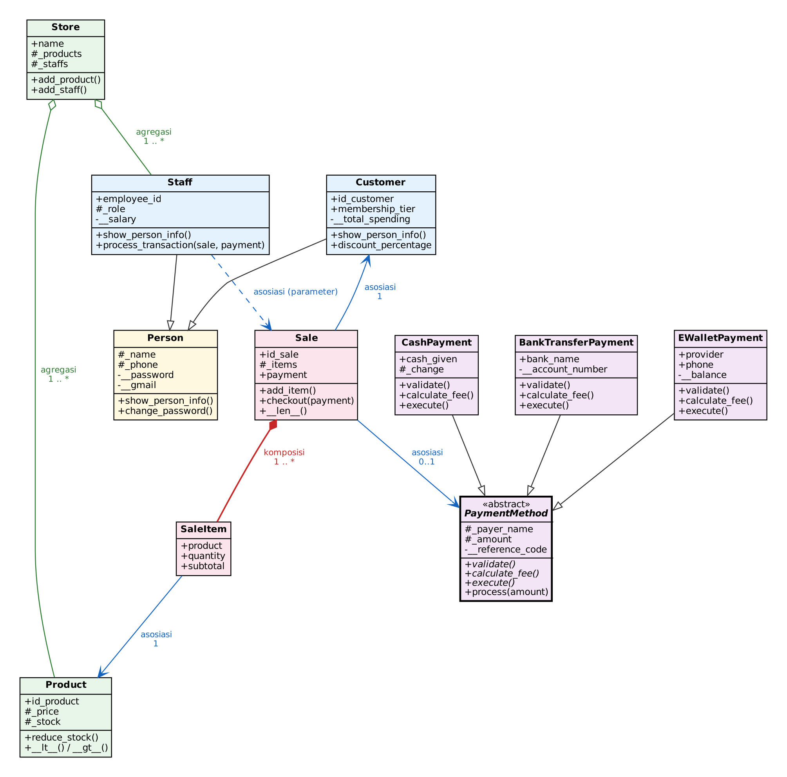
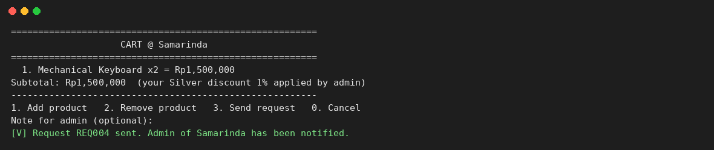
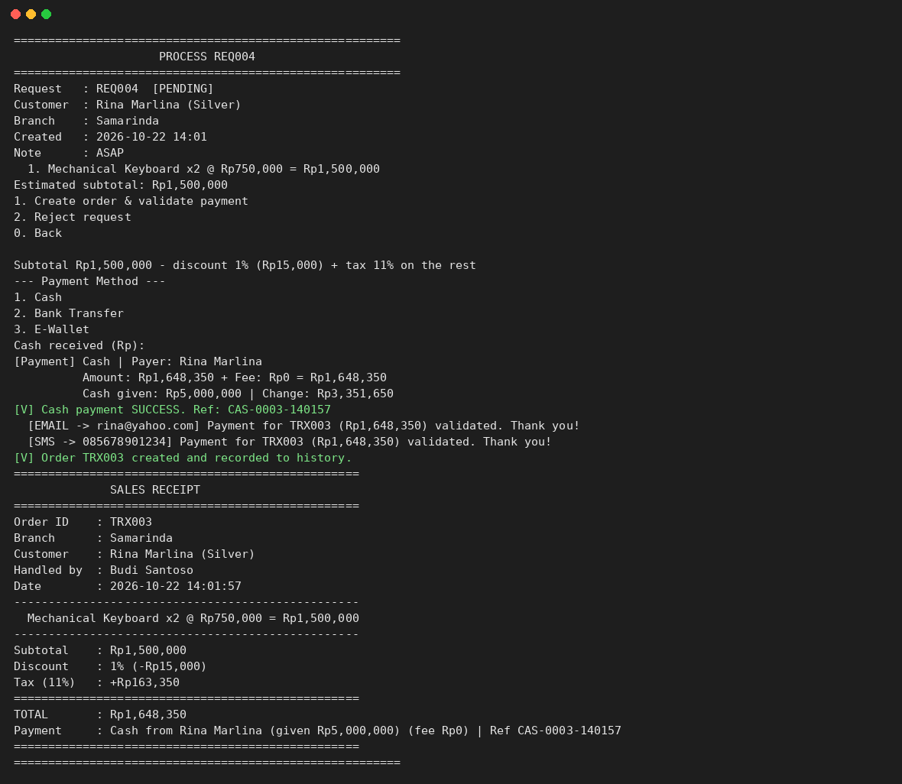
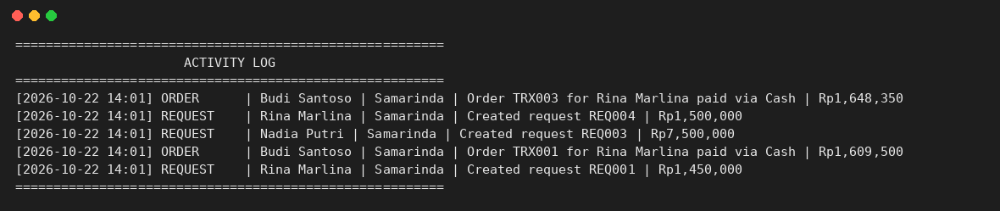
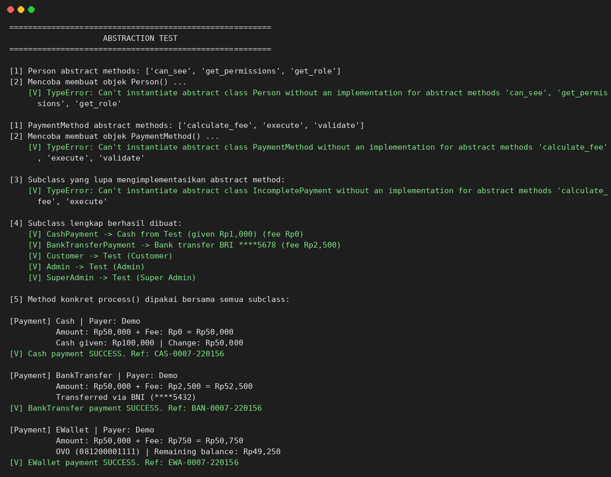
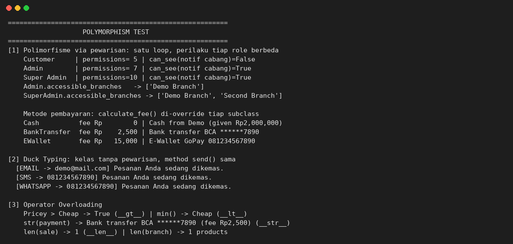
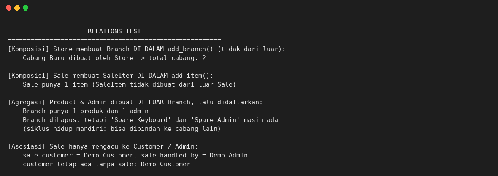
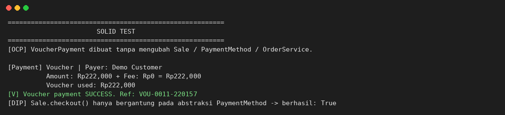

# Sistem Manajemen Penjualan Perangkat dan Aksesori Komputer

> **Nama:** Muhammad Alfauzi Syahputra
> **Mata Kuliah:** Pemrograman Berorientasi Objek (OOP)
> **Bahasa:** Python 3 (hanya standard library, tanpa library tambahan)
> **Tugas:** Posttest 3 — Polimorfisme & Abstraksi

---

## Daftar Isi

1. [Deskripsi Program](#1-deskripsi-program)
2. [Checklist Ketentuan Posttest](#2-checklist-ketentuan-posttest)
3. [Role, Hak Akses, dan Alur Belanja](#3-role-hak-akses-dan-alur-belanja)
4. [Struktur Proyek](#4-struktur-proyek)
5. [Class Diagram & Relasi UML](#5-class-diagram--relasi-uml)
6. [Abstraksi (Abstract Base Class)](#6-abstraksi-abstract-base-class)
7. [Polimorfisme](#7-polimorfisme)
8. [Nilai Plus: Prinsip SOLID](#8-nilai-plus-prinsip-solid)
9. [Alur Program Langkah demi Langkah di Dalam Kode](#9-alur-program-langkah-demi-langkah-di-dalam-kode)
10. [Cara Menjalankan & Pengujian](#10-cara-menjalankan--pengujian)
11. [Screenshot Output](#11-screenshot-output)
12. [Catatan Desain dan Keterbatasan](#12-catatan-desain-dan-keterbatasan)

---

## 1. Deskripsi Program

Program ini adalah aplikasi **CLI (Command Line Interface)** untuk mengelola toko perangkat dan aksesori komputer yang memiliki **banyak cabang**. Ada tiga jenis pengguna:

| Role | Singkatnya |
|---|---|
| **Customer** | Melihat produk dan berbelanja (mengirim *request* belanja) |
| **Admin** | Pegawai satu cabang: memproses request, membuat pesanan, memvalidasi pembayaran, mengelola produk dan customer cabangnya |
| **Super Admin** | Pemilik: semua akses admin di semua cabang, ditambah mengelola admin, profil toko, dan cabang |

Inti program adalah **alur belanja**:

```text
Customer pilih barang
      │  (membuat OrderRequest)
      ▼
Notifikasi dikirim ke admin cabang
      │
      ▼
Admin membuat pesanan (Sale) dan memvalidasi pembayaran (PaymentMethod)
      │
      ▼
Masuk ke log / history / catatan (ActivityLog) + customer diberi tahu
```

Pada posttest ini, konsep yang diterapkan adalah **Relasi UML**, **Abstraksi**, dan **Polimorfisme**. Konsep dari posttest sebelumnya (inheritance dengan `super().__init__()`, atribut unik subclass, atribut *protected* dan *private*) tetap dipakai.

---

## 2. Checklist Ketentuan Posttest

Tabel ini memetakan setiap ketentuan soal ke lokasi implementasinya di kode, supaya mudah diperiksa.

| # | Ketentuan | Dipenuhi oleh | File |
|---|---|---|---|
| 1 | Class Diagram sebagai gambar di README | `assets/class_diagram.png` (bagian 5) | `assets/` |
| 1 | Relasi **Asosiasi** ada di kode | `Sale.customer`, `Sale.handled_by`, `Sale.payment`, `OrderRequest.customer`, `SaleItem.product` | `models/sale.py`, `order_request.py`, `sale_item.py` |
| 1 | Relasi **Agregasi** ada di kode | `Branch` ◇— `Product` dan `Admin` | `models/branch.py` |
| 1 | Relasi **Komposisi** ada di kode | `Store` ◆— `Branch`, `Sale` ◆— `SaleItem`, `OrderRequest` ◆— `SaleItem` | `models/store.py`, `sale.py`, `order_request.py` |
| 2 | Abstract class (ABC) dengan ≥ 2 `@abstractmethod` | `PaymentMethod` (3 abstract method) dan `Person` (3 abstract method) | `models/payment.py`, `models/person.py` |
| 2 | ≥ 2 subclass mengimplementasikan semua abstract method | `CashPayment`, `BankTransferPayment`, `EWalletPayment`; `Customer`, `Admin` (→ `SuperAdmin`) | sama seperti di atas |
| 2 | Method konkret yang dipakai bersama | `PaymentMethod.process()` (setara `jalankan()` di materi) | `models/payment.py` |
| 2 | Bukti abstract class tidak bisa diinstansiasi | menu **OOP Testing → 3** (`TypeError`) | `menus/testing_menu.py` |
| 2 | `super().__init__()`, atribut unik, protected/private | semua subclass (bagian 6.4) | `models/` |
| 3 | Polimorfisme via pewarisan (override + satu loop) | `calculate_fee()`, `get_permissions()`, `accessible_branches()` | `models/payment.py`, `admin.py`, `customer.py` |
| 3 | Duck typing (kelas tidak berpewarisan, method sama) | `EmailNotifier`, `SMSNotifier`, `WhatsAppNotifier` → `send()` | `models/notifier.py` |
| 3 | Operator overloading (≥ 1 magic method) | `__lt__`, `__gt__`, `__len__`, `__str__` (bagian 7.3) | `product.py`, `sale.py`, dll. |
| 3 | Tanpa `if/elif` yang mengecek `type()` / string jenis | menu dari permission, tier dari tabel, pembayaran dari tabel (bagian 7.4) | `menus/dashboard.py`, dll. |
| + | SOLID (nilai plus) | **DIP** dan **OCP** (+ **SRP**) (bagian 8) | `sale.py`, `order_service.py` |

---

## 3. Role, Hak Akses, dan Alur Belanja

### 3.1 Hak akses tiap role

| Fitur | Customer | Admin | Super Admin |
|---|:---:|:---:|:---:|
| Melihat produk (per cabang, bisa urut harga) | ✔ | — | — |
| Belanja (mengirim request) | ✔ | — | — |
| Melihat status pesanan sendiri | ✔ | — | — |
| Notifikasi | ✔ (milik sendiri) | ✔ (cabangnya) | ✔ (semua cabang) |
| Ubah profil & akun (username, password) sendiri | ✔ | ✔ | ✔ |
| Memproses request customer (buat pesanan, validasi pembayaran, atau tolak) | — | ✔ (cabangnya) | ✔ (semua cabang) |
| Membuat pesanan langsung (customer datang ke toko) | — | ✔ | ✔ |
| Kelola produk | — | ✔ (cabangnya) | ✔ (semua cabang) |
| Kelola customer (tambah, ubah profil/akun, reset password, aktif/nonaktif) | — | ✔ | ✔ |
| History / log | — | ✔ (cabangnya) | ✔ (semua cabang) |
| Membuat & mengelola akun admin | — | — | ✔ |
| Ubah profil toko | — | — | ✔ |
| Tambah / ubah / hapus cabang | — | — | ✔ |

Di kode, tabel ini **bukan** ditulis sebagai rantai `if role == ...`. Setiap kelas role menyatakan haknya sendiri lewat method `get_permissions()` (lihat bagian 7.1 dan 7.4).

### 3.2 Alur belanja

1. **Customer memilih barang.** Menu *Shop* → pilih cabang → tambah barang ke keranjang → *Send request*. Kode: `menus/customer_actions.py → shop()` memanggil `OrderService.submit_request()`.
2. **Notifikasi untuk admin.** `submit_request()` membuat objek `OrderRequest` (status `PENDING`) dan `Notification` yang ditujukan ke cabang tersebut.
3. **Admin membuat pesanan dan memvalidasi pembayaran.** Menu *Customer Requests* → pilih request → *Create order & validate payment* → pilih metode dan isi data pembayaran. `OrderService.fulfill_request()` membuat `Sale`, memanggil `Sale.checkout(payment)` yang memvalidasi pembayaran lewat `PaymentMethod.process()`. Admin juga bisa **menolak** request dengan alasan.
4. **Masuk ke log/history.** Hasilnya dicatat di `ActivityLog`; `Sale` disimpan di daftar pesanan; customer menerima notifikasi (dalam aplikasi dan Email/SMS).

Penjelasan alur sampai ke baris kode ada di [bagian 9](#9-alur-program-langkah-demi-langkah-di-dalam-kode).

---

## 4. Struktur Proyek

```text
posttest3/
├── main.py                      # menu utama: Login, Register, OOP Testing, Exit
├── seed.py                      # data awal (dibuat lewat alur yang sama dengan aplikasi)
├── requirements.txt             # kosong (hanya standard library)
├── models/                      # kelas-kelas inti (logika bisnis)
│   ├── person.py                # Person (ABC)
│   ├── customer.py              # Customer(Person)
│   ├── admin.py                 # Admin(Person), SuperAdmin(Admin)
│   ├── store.py                 # Store (profil toko)
│   ├── branch.py                # Branch (cabang)
│   ├── product.py               # Product
│   ├── order_request.py         # OrderRequest (request dari customer)
│   ├── sale.py                  # Sale (pesanan resmi)
│   ├── sale_item.py             # SaleItem (baris barang)
│   ├── payment.py               # PaymentMethod (ABC) + 3 subclass
│   ├── notifier.py              # Email/SMS/WhatsApp (duck typing)
│   ├── notification.py          # Notification (notifikasi dalam aplikasi)
│   ├── activity_log.py          # ActivityLog + LogEntry (history)
│   ├── app_data.py              # AppData (penyimpanan data in-memory)
│   └── order_service.py         # OrderService (alur request → order → log)
├── menus/                       # lapisan tampilan (input/output)
│   ├── dashboard.py             # menu dibangun dari permission role
│   ├── customer_actions.py      # aksi customer
│   ├── admin_actions.py         # aksi admin
│   ├── superadmin_actions.py    # aksi super admin
│   ├── profile_actions.py       # profil & akun (dipakai semua role)
│   ├── payment_prompt.py        # pilihan metode pembayaran
│   ├── auth.py                  # login & registrasi
│   └── testing_menu.py          # menu OOP Testing
├── utils/helper.py              # fungsi bantu input/output
└── assets/                      # class diagram & screenshot
```

Pemisahan tiga lapisan (**models** = logika, **menus** = tampilan, **utils** = bantuan) membuat kelas model bisa diuji tanpa tampilan.

---

## 5. Class Diagram & Relasi UML



**Cara membaca simbol:**

| Simbol | Arti |
|---|---|
| Segitiga kosong (▷) | Inheritance (pewarisan) |
| Belah ketupat **kosong** (◇) di sisi "pemilik" | **Agregasi** |
| Belah ketupat **penuh** (◆) di sisi "pemilik" | **Komposisi** |
| Panah terbuka (→) | **Asosiasi** |
| Nama miring + `«abstract»` | Abstract class |

Diagram sengaja disederhanakan: hanya nama kelas, atribut/method utama, dan garis relasi. Tanda `+` public, `#` protected, `-` private.

### 5.1 Asosiasi — "menggunakan / mengacu ke"

**Konsep.** Satu objek hanya menyimpan *referensi* ke objek lain. Kedua objek punya siklus hidup sendiri-sendiri; menghapus salah satunya tidak menghapus yang lain.

**Relasi di program:** `Sale` → `Customer`, `Sale` → `Admin` (`handled_by`), `Sale` → `PaymentMethod`, `OrderRequest` → `Customer`, `SaleItem` → `Product`.

**Implementasi** (`models/sale.py`):

```python
class Sale:
    def __init__(self, id_sale, customer, branch, handled_by):
        self.customer = customer        # Asosiasi: Sale -> Customer
        self.branch = branch            # Asosiasi: Sale -> Branch
        self.handled_by = handled_by    # Asosiasi: Sale -> Admin
        self.payment = None             # Asosiasi: Sale -> PaymentMethod
```

**Alasan memilih asosiasi.** `Customer`, `Admin`, dan metode pembayaran sudah ada sebelum `Sale` dibuat dan tetap ada setelahnya. Satu customer bisa punya banyak `Sale`; satu admin memproses banyak `Sale`. `Sale` hanya perlu *mengacu* ke mereka, bukan memilikinya.

### 5.2 Agregasi — "memiliki, tetapi bagian bisa hidup sendiri"

**Konsep.** Objek "induk" menyimpan kumpulan objek "bagian" yang **dibuat di luar** induk. Jika induk dihapus, bagian tetap ada dan bisa dipakai di tempat lain.

**Relasi di program:** `Branch` ◇— `Product` dan `Branch` ◇— `Admin`.

**Implementasi** (`models/branch.py`):

```python
class Branch:
    def __init__(self, branch_id, name, address, phone):
        self._products = []         # Agregasi: Branch o-- Product
        self._admins = []           # Agregasi: Branch o-- Admin

    def add_product(self, product):     # product DIBUAT DI LUAR, lalu didaftarkan
        ...
        self._products.append(product)

    def add_admin(self, admin):
        if admin not in self._admins:
            self._admins.append(admin)
        admin.branch = self
```

Objeknya dibuat di luar `Branch`, misalnya di `seed.py`:

```python
smr = store.add_branch("Samarinda", ...)
smr.add_product(Product("P001", "Mechanical Keyboard", 750000, 10, "Peripheral"))   # Product dibuat di luar Branch
admin_smr = app.register_admin("Budi Santoso", "admin_smr", ..., smr)               # Admin dibuat di luar Branch
```

**Alasan memilih agregasi (bukan komposisi).** Seorang `Admin` bisa **dipindahkan** ke cabang lain oleh Super Admin (`Branch.remove_admin()` lalu `add_admin()` di cabang baru), jadi `Admin` jelas tidak "mati" bersama cabang lamanya. Begitu juga `Product` yang dibuat sendiri dan baru kemudian didaftarkan ke cabang. Bagian bisa berdiri sendiri, maka relasinya agregasi.

### 5.3 Komposisi — "terdiri dari, bagian ikut hilang bersama induk"

**Konsep.** Objek "bagian" **dibuat di dalam** induk dan tidak bermakna tanpa induknya. Jika induk hilang, bagian ikut hilang.

**Relasi di program:**
- `Store` ◆— `Branch`
- `Sale` ◆— `SaleItem`
- `OrderRequest` ◆— `SaleItem`

**Implementasi** (`models/store.py` — `Branch` dibuat di dalam `Store`, tidak dari luar):

```python
def add_branch(self, name, address, phone):
    """Komposisi: objek Branch dibuat di dalam Store, tidak dari luar."""
    ...
    branch = Branch(f"B{len(self._branches) + 1:02d}", name.strip(), address.strip(), phone.strip())
    self._branches.append(branch)
    return branch
```

**Implementasi** (`models/sale.py` — `SaleItem` dibuat di dalam `Sale`):

```python
def add_item(self, product, quantity):
    """Membuat SaleItem DI DALAM Sale (komposisi) dan mengurangi stok."""
    ...
    existing = next((i for i in self._items if i.product is product), None)
    if existing:
        existing.quantity += quantity
    else:
        self._items.append(SaleItem(product, quantity))      # dibuat di dalam Sale
    product.reduce_stock(quantity)
    return True
```

`OrderRequest.add_item()` bekerja sama: ia juga membuat `SaleItem` di dalamnya.

**Alasan memilih komposisi.**
- `SaleItem` adalah satu baris di nota: ia tidak berarti tanpa `Sale`/`OrderRequest` yang memilikinya, dan tidak pernah dibuat dari luar.
- Sebuah `Branch` (cabang) tidak ada tanpa toko induknya, sehingga hanya bisa dibuat lewat `Store.add_branch()`.

### 5.4 Agregasi vs Komposisi (ringkasan pembeda)

| Pertanyaan | Agregasi (`Branch` → `Admin`/`Product`) | Komposisi (`Sale` → `SaleItem`, `Store` → `Branch`) |
|---|---|---|
| Objek "bagian" dibuat di mana? | Di **luar** induk, lalu didaftarkan | Di **dalam** induk |
| Bisa dipindah ke induk lain? | Ya (admin dipindah cabang) | Tidak |
| Bermakna tanpa induk? | Ya | Tidak |
| Simbol | ◇ (kosong) | ◆ (penuh) |

### 5.5 Bukti relasi di program

Menu **OOP Testing → 2** membuktikan ketiga relasi dengan objek sementara (data utama tidak berubah). Output sebenarnya:

```text
[Komposisi] Store membuat Branch DI DALAM add_branch() (tidak dari luar):
    Cabang Baru dibuat oleh Store -> total cabang: 2

[Komposisi] Sale membuat SaleItem DI DALAM add_item():
    Sale punya 1 item (SaleItem tidak dibuat dari luar Sale)

[Agregasi] Product & Admin dibuat DI LUAR Branch, lalu didaftarkan:
    Branch punya 1 produk dan 1 admin
    Branch dihapus, tetapi 'Spare Keyboard' dan 'Spare Admin' masih ada
    (siklus hidup mandiri: bisa dipindah ke cabang lain)

[Asosiasi] Sale hanya mengacu ke Customer / Admin:
    sale.customer = Demo Customer, sale.handled_by = Demo Admin
    customer tetap ada tanpa sale: Demo Customer
```

---

## 6. Abstraksi (Abstract Base Class)

### 6.1 Konsep

**Abstraksi** berarti menyembunyikan detail dan hanya menampilkan *kontrak*: "apa yang harus bisa dilakukan", tanpa menentukan "bagaimana caranya". Di Python ini dibuat dengan **ABC (Abstract Base Class)** dan dekorator `@abstractmethod`.

Aturannya:
1. Abstract class **tidak bisa dibuat objeknya** (`TypeError`).
2. Subclass **wajib** mengimplementasikan semua `@abstractmethod`; kalau ada yang terlewat, subclass itu pun tidak bisa dibuat objeknya.
3. Abstract class boleh punya **method konkret** yang dipakai bersama semua subclass.

Manfaatnya: kesalahan (method lupa dibuat) ketahuan **saat objek dibuat**, bukan saat program sudah berjalan jauh.

Program ini memakai dua abstract class.

### 6.2 Abstract class `PaymentMethod` (`models/payment.py`)

Kontrak untuk semua metode pembayaran. Setiap metode punya aturan validasi, biaya, dan cara eksekusi sendiri, tetapi **alur pembayarannya sama**.

```python
class PaymentMethod(ABC):
    def __init__(self, payer_name):
        self._payer_name = payer_name.strip()      # Protected: dipakai subclass
        self._amount = 0                           # Protected: diisi saat process()
        self.__reference_code = ""                 # Private: dibuat otomatis
        self.is_paid = False

    # ---------- Abstract methods (kontrak) ----------
    @abstractmethod
    def validate(self):
        """Kembalikan True jika pembayaran boleh dilakukan."""

    @abstractmethod
    def calculate_fee(self):
        """Kembalikan biaya tambahan metode pembayaran ini (Rp)."""

    @abstractmethod
    def execute(self):
        """Lakukan pembayaran (ubah saldo / catat uang masuk)."""

    # ---------- Method konkret (dipakai bersama semua subclass) ----------
    def get_total_charge(self):
        return self._amount + self.calculate_fee()

    def process(self, amount):
        """Alur yang sama untuk semua metode: validasi -> eksekusi -> status."""
        ...
        self._amount = amount
        if not self.validate():          # diserahkan ke subclass
            self.is_paid = False
            return False
        self.execute()                   # diserahkan ke subclass
        self._generate_reference()
        self.is_paid = True
        return True
```

| Bagian | Isi |
|---|---|
| **Abstract method (3)** | `validate()`, `calculate_fee()`, `execute()` |
| **Method konkret** | `process(amount)`, `get_total_charge()`, `describe()`, `__str__`, `_generate_reference()` |

`process()` adalah method konkret yang setara dengan `jalankan()` di materi: ia **tidak perlu tahu** jenis pembayarannya, hanya memanggil `validate()` dan `execute()`, dan tiap subclass menjawab dengan caranya sendiri.

### 6.3 Subclass yang mengimplementasikan semua abstract method

| Subclass | `validate()` | `calculate_fee()` | `execute()` |
|---|---|---|---|
| `CashPayment` | uang diterima ≥ total tagihan | Rp0 | hitung kembalian |
| `BankTransferPayment` | nomor rekening angka 8–16 digit | Rp2.500 (tetap) | catat transfer via bank |
| `EWalletPayment` | nomor HP valid dan saldo ≥ total tagihan | 1,5% dari nominal | kurangi saldo dompet digital |

Contoh (`CashPayment`):

```python
class CashPayment(PaymentMethod):
    method_name = "Cash"

    def __init__(self, payer_name, cash_given):
        super().__init__(payer_name)            # memanggil konstruktor parent
        self.cash_given = cash_given            # atribut unik subclass
        self._change = 0                        # protected: kembalian

    def validate(self):
        return self.cash_given >= self.get_total_charge()

    def calculate_fee(self):
        return 0

    def execute(self):
        self._change = self.cash_given - self.get_total_charge()
```

### 6.4 Abstract class kedua: `Person` (`models/person.py`)

`Person` adalah kontrak untuk semua pengguna. Data akun dan profil diurus satu kali di `Person`; **apa yang boleh dilakukan** setiap role dipaksakan lewat tiga abstract method:

```python
class Person(ABC):
    @abstractmethod
    def get_role(self):
        """Nama role pengguna."""

    @abstractmethod
    def get_permissions(self):
        """Kumpulan kunci aksi yang boleh dilakukan role ini."""

    @abstractmethod
    def can_see(self, notification):
        """True jika notifikasi tersebut boleh dilihat pengguna ini."""
```

Method konkretnya (dipakai bersama `Customer`, `Admin`, `SuperAdmin`): `set_password()`, `verify_password()`, `change_password()`, `update_profile()`, `show_person_info()`, dan `__str__`.

Subclass: `Customer(Person)`, `Admin(Person)`, dan `SuperAdmin(Admin)` — ketiganya mengimplementasikan seluruh abstract method.

### 6.5 Inheritance tetap dipakai: `super().__init__()`, atribut unik, protected/private

```python
class Customer(Person):
    def __init__(self, id_customer, name, username, password, phone, gmail, address,
                 birth_date="", gender=""):
        super().__init__(name, username, password, phone, gmail, birth_date, gender)
        self.id_customer = id_customer      # unik Customer
        self._address = ""                  # protected
        self.address = address              # lewat setter (validasi)
        self.membership_tier = "Bronze"
        self.loyalty_points = 0
        self.__total_spending = 0           # private

class Admin(Person):
    def __init__(self, employee_id, name, username, password, phone, gmail,
                 branch=None, birth_date="", gender=""):
        super().__init__(name, username, password, phone, gmail, birth_date, gender)
        self.employee_id = employee_id      # unik Admin
        self.branch = branch
        self._orders_processed = 0          # protected
```

| Kelas | Protected (`_x`) | Private (`__x`) | Alasan |
|---|---|---|---|
| `Person` | `_name`, `_username`, `_phone` | `__password`, `__gmail` | Data sensitif (password, email) hanya bisa diubah lewat method/setter ber-validasi; nama dan telepon boleh diakses subclass |
| `Customer` | `_address` | `__total_spending` | Total belanja hanya boleh berubah lewat `add_spending()` agar tier membership konsisten |
| `Admin` | `_orders_processed` | — | Hanya berubah lewat `record_order()` |
| `PaymentMethod` | `_payer_name`, `_amount` | `__reference_code` | Subclass perlu `_amount`; kode referensi tidak boleh diubah dari luar |
| `BankTransferPayment` | — | `__account_number` | Nomor rekening sensitif; ditampilkan hanya dalam bentuk tersamar (`****5678`) |
| `EWalletPayment` | — | `__balance` | Saldo hanya berubah lewat `execute()` |

### 6.6 Bukti: abstract class tidak bisa diinstansiasi

Menu **OOP Testing → 3 (Test Abstraction)**:

```python
try:
    PaymentMethod("x")
except TypeError as error:
    print(error)
```

Output sebenarnya dari program:

```text
[1] Person abstract methods: ['can_see', 'get_permissions', 'get_role']
[2] Mencoba membuat objek Person() ...
    [V] TypeError: Can't instantiate abstract class Person without an implementation for abstract methods 'can_see', 'get_permissions', 'get_role'

[1] PaymentMethod abstract methods: ['calculate_fee', 'execute', 'validate']
[2] Mencoba membuat objek PaymentMethod() ...
    [V] TypeError: Can't instantiate abstract class PaymentMethod without an implementation for abstract methods 'calculate_fee', 'execute', 'validate'

[3] Subclass yang lupa mengimplementasikan abstract method:
    [V] TypeError: Can't instantiate abstract class IncompletePayment without an implementation for abstract methods 'calculate_fee', 'execute'

[4] Subclass lengkap berhasil dibuat:
    [V] CashPayment -> Cash from Test (given Rp1,000) (fee Rp0)
    [V] BankTransferPayment -> Bank transfer BRI ****5678 (fee Rp2,500)
    [V] Customer -> Test (Customer)
    [V] Admin -> Test (Admin)
    [V] SuperAdmin -> Test (Super Admin)
```

Poin [3] membuktikan aturan kedua: `IncompletePayment` hanya mengimplementasikan `validate()`, jadi **ikut tidak bisa dibuat** dan Python menyebut method apa yang masih kurang. Poin [5] pada menu yang sama menjalankan `process()` pada tiga subclass untuk membuktikan method konkret bersama (lihat [bagian 11](#11-screenshot-output)).

---

## 7. Polimorfisme

### 7.1 Polimorfisme via pewarisan (override + satu loop)

**Konsep.** Satu nama method, banyak perilaku. Subclass meng-*override* method milik parent, dan Python memilih versi yang tepat saat program berjalan (*dynamic dispatch*) sesuai tipe objek sebenarnya. Pemanggil tidak perlu tahu tipenya.

**Contoh A — metode pembayaran.** `calculate_fee()` di-override oleh tiga subclass dengan perilaku berbeda:

```python
# CashPayment
def calculate_fee(self):
    return 0

# BankTransferPayment
def calculate_fee(self):
    return BankTransferPayment.ADMIN_FEE          # 2500

# EWalletPayment
def calculate_fee(self):
    return self._amount * EWalletPayment.FEE_RATE # 1,5%
```

Dipanggil lewat **satu loop** berisi objek dari subclass berbeda (menu **OOP Testing → 4**):

```python
payments = [CashPayment("Demo", 2_000_000),
            BankTransferPayment("Demo", "BCA", "1234567890"),
            EWalletPayment("Demo", "GoPay", "081234567890", 5_000_000)]
for payment in payments:
    payment._amount = 1_000_000
    print(payment.method_name, payment.calculate_fee(), payment.describe())
```

```text
Cash          fee Rp        0 | Cash from Demo (given Rp2,000,000)
BankTransfer  fee Rp    2,500 | Bank transfer BCA ******7890
EWallet       fee Rp   15,000 | E-Wallet GoPay 081234567890
```

Di alur nyata, pola yang sama ada di `Sale.checkout()` (`models/sale.py`): ia cukup memanggil `payment.process(self.total)` tanpa mengecek jenis pembayaran.

**Contoh B — role pengguna.** `get_permissions()`, `can_see()`, dan `accessible_branches()` di-override oleh `Customer`, `Admin`, dan `SuperAdmin`:

```python
class Admin(Person):
    def can_see(self, notification):
        return notification.branch is not None and notification.branch is self.branch

    def accessible_branches(self, store):
        """Admin biasa hanya boleh bekerja di cabangnya sendiri."""
        return [self.branch] if self.branch else []


class SuperAdmin(Admin):
    PERMISSIONS = Admin.PERMISSIONS | {"manage_admins", "store_profile", "manage_branches"}

    def can_see(self, notification):
        return notification.branch is not None      # melihat notifikasi semua cabang

    def accessible_branches(self, store):
        return list(store.branches)                 # semua cabang
```

Kode lain cukup memanggil `user.accessible_branches(store)` tanpa peduli role. Misalnya `select_branch()` di `menus/admin_actions.py` berlaku untuk admin dan super admin sekaligus. Output uji (`OOP Testing → 4`):

```text
Customer     | permissions= 5 | can_see(notif cabang)=False
Admin        | permissions= 7 | can_see(notif cabang)=True
Super Admin  | permissions=10 | can_see(notif cabang)=True
Admin.accessible_branches   -> ['Demo Branch']
SuperAdmin.accessible_branches -> ['Demo Branch', 'Second Branch']
```

Perhatikan perbedaan baris terakhir: dengan dua cabang, admin hanya mendapat satu, super admin mendapat dua.

### 7.2 Duck Typing (polimorfisme tanpa pewarisan)

**Konsep.** "Jika berjalan seperti bebek dan bersuara seperti bebek, ia bebek." Python tidak mempermasalahkan kelas/pewarisan; selama objek punya method yang dibutuhkan, ia bisa dipakai.

**Implementasi** (`models/notifier.py`). Tiga kelas **tidak berpewarisan** satu sama lain dan tidak punya parent bersama, tetapi sama-sama punya `send(message)`:

```python
class EmailNotifier:
    def __init__(self, address): self.address = address
    def send(self, message):
        print(f"  [EMAIL -> {self.address}] {message}")

class SMSNotifier:
    def __init__(self, phone): self.phone = phone
    def send(self, message):
        print(f"  [SMS -> {self.phone}] {message}")

class WhatsAppNotifier:
    def __init__(self, phone): self.phone = phone
    def send(self, message):
        print(f"  [WHATSAPP -> {self.phone}] {message}")
```

Semuanya dipanggil lewat **satu fungsi** yang sama:

```python
def notify_customer(channels, message):
    """Duck typing: kanal apa pun yang punya send() bisa dipakai."""
    for channel in channels:
        channel.send(message)
```

Dipakai nyata di `OrderService._pay()` setelah pembayaran divalidasi (`build_channels(customer)` mengembalikan kanal Email dan SMS milik customer). Output uji:

```text
[EMAIL -> demo@mail.com] Pesanan Anda sedang dikemas.
[SMS -> 081234567890] Pesanan Anda sedang dikemas.
[WHATSAPP -> 081234567890] Pesanan Anda sedang dikemas.
```

**Kenapa duck typing di sini dan ABC di pembayaran?** Pembayaran adalah hierarki yang kita kendalikan dan butuh *kontrak formal* (error saat instansiasi) sehingga memakai ABC. Kanal notifikasi bersifat longgar dan mudah ditambah (cukup kelas baru ber-`send()`), sehingga duck typing lebih sesuai.

### 7.3 Operator Overloading

**Konsep.** Mendefinisikan ulang perilaku operator/fungsi bawaan Python (`<`, `>`, `len()`, `str()`) untuk kelas buatan sendiri lewat *magic method*.

| Kelas | Magic method | Fungsi | Dipakai di |
|---|---|---|---|
| `Product` | `__lt__`, `__gt__` | membandingkan harga | `sorted(products)` pada *View Products → urut harga* (`customer_actions.py`) |
| `Product` | `__str__` | `[P001] Nama - Rp... (Stock: n)` | daftar produk |
| `Sale` | `__len__` | jumlah item | `len(sale)` |
| `Sale` | `__lt__`, `__gt__` | membandingkan total | perbandingan antar pesanan |
| `Sale` | `__str__` | ringkasan pesanan | daftar pesanan di History |
| `OrderRequest` | `__len__`, `__str__` | jumlah item, ringkasan | pesan notifikasi dan daftar request |
| `PaymentMethod` | `__lt__`, `__gt__` | membandingkan fee | `min(payments)` |
| `PaymentMethod` | `__str__` | deskripsi + fee | tampilan di struk |
| `Branch`, `Store` | `__len__`, `__str__` | jumlah produk / cabang | menu Manage Branches, Store Profile |

Contoh (`models/product.py`):

```python
def __lt__(self, other):
    return self._price < other._price

def __gt__(self, other):
    return self._price > other._price
```

Karena `__lt__` sudah ada, `sorted()` dan `min()` langsung bekerja pada objek `Product`:

```python
if order == "2":
    products = sorted(products)                  # memakai Product.__lt__
elif order == "3":
    products = sorted(products, reverse=True)
```

Output uji (`OOP Testing → 4`):

```text
Pricey > Cheap -> True (__gt__) | min() -> Cheap (__lt__)
str(payment) -> Bank transfer BCA ******7890 (fee Rp2,500) (__str__)
len(sale) -> 1 (__len__) | len(branch) -> 1 products
```

### 7.4 Larangan anti-pattern: tidak ada `if/elif` pengecek tipe/jenis

Soal melarang membedakan perilaku objek dengan rantai `if/elif` yang mengecek `type()` atau string jenis. Contoh pola buruk yang **dihindari**:

```python
# BURUK (tidak dipakai di program ini)
if user.role == "admin": ...
elif user.role == "customer": ...

if type(payment) == CashPayment: fee = 0
elif type(payment) == BankTransferPayment: fee = 2500
```

Penggantinya di program ini: **biarkan objek menentukan perilakunya sendiri**.

| Kebutuhan | Cara yang dipakai | Lokasi |
|---|---|---|
| Menu berbeda per role | Menu dibangun dari `user.get_permissions()`; tiap role menyatakan haknya sendiri | `menus/dashboard.py → build_menu()` |
| Biaya per metode pembayaran | Method `calculate_fee()` per subclass | `models/payment.py` |
| Cabang yang boleh diakses | Method `accessible_branches()` per role | `models/admin.py` |
| Notifikasi yang boleh dilihat | Method `can_see()` per role | `models/admin.py`, `customer.py` |
| Diskon per tier membership | Tabel data `Customer.DISCOUNT_RATES` | `models/customer.py` |
| Penentuan tier dari total belanja | Tabel `Customer.TIERS` + `next(...)` | `models/customer.py` |
| Pilihan metode pembayaran di menu | Dictionary `PAYMENT_OPTIONS` | `menus/payment_prompt.py` |

Dua contoh kodenya:

```python
# menus/dashboard.py — menu dibangun dari permission milik objek user
def build_menu(app, user):
    permissions = user.get_permissions()
    menu = []
    for key, label, handler in ALL_ACTIONS:
        if key in permissions:
            menu.append((label(app, user) if callable(label) else label, handler))
    return menu

# models/customer.py — tier ditentukan dari tabel data, bukan rantai if/elif
new_tier = next(tier for limit, tier in Customer.TIERS if self.__total_spending >= limit)
```

> Catatan: `isinstance()` hanya dipakai untuk *menyaring daftar* (`AppData.customers` / `AppData.admins`) dan *memvalidasi tipe angka* pada setter `Product`, bukan untuk menentukan perilaku objek.

---

## 8. Nilai Plus: Prinsip SOLID

Penerapan di bawah benar-benar ada di kode dan tidak mengurangi syarat wajib poin 1–3.

### 8.1 DIP — Dependency Inversion Principle

*Modul tingkat tinggi tidak boleh bergantung pada kelas konkret, tetapi pada abstraksi.*

`Sale.checkout()` menerima objek pembayaran dari luar (**dependency injection**) dan hanya bergantung pada abstraksi `PaymentMethod`. Ia tidak meng-*import* `CashPayment`, `BankTransferPayment`, atau `EWalletPayment`:

```python
def checkout(self, payment):
    """Bayar lalu selesaikan. Hanya bergantung pada abstraksi PaymentMethod (DIP)."""
    ...
    self.calculate_total()
    if not payment.process(self.total):       # tidak peduli jenis pembayarannya
        return False
    self.payment = payment
    self.customer.add_points(int(self.total // 10000))
    self.customer.add_spending(self.total)
    ...
```

### 8.2 OCP — Open/Closed Principle

*Terbuka untuk ditambah, tertutup untuk diubah.*

Metode pembayaran baru cukup dibuat sebagai subclass `PaymentMethod`, **tanpa mengubah** `Sale`, `PaymentMethod`, atau `OrderService`. Dibuktikan di **OOP Testing → 5**: kelas `VoucherPayment` dibuat di dalam fungsi uji, lalu langsung bisa dipakai `Sale.checkout()`:

```python
class VoucherPayment(PaymentMethod):
    method_name = "Voucher"
    def __init__(self, payer_name, value):
        super().__init__(payer_name)
        self.value = value
    def validate(self):    return self.value >= self._amount
    def calculate_fee(self): return 0
    def execute(self):     print(f"          Voucher used: Rp{self._amount:,.0f}")
```

```text
[OCP] VoucherPayment dibuat tanpa mengubah Sale / PaymentMethod / OrderService.

[Payment] Voucher | Payer: Demo Customer
          Amount: Rp222,000 + Fee: Rp0 = Rp222,000
          Voucher used: Rp222,000
[V] Voucher payment SUCCESS. Ref: VOU-0011-220150
[DIP] Sale.checkout() hanya bergantung pada abstraksi PaymentMethod -> berhasil: True
```

Pada menu aplikasi, menambah metode baru hanya perlu satu baris di tabel `PAYMENT_OPTIONS` (`menus/payment_prompt.py`). Hal serupa berlaku untuk aksi menu baru: cukup satu entri di registry `ALL_ACTIONS` dan satu kunci permission.

### 8.3 SRP — Single Responsibility Principle

Tanggung jawab dipisah per kelas:

| Kelas / lapisan | Tanggung jawab tunggal |
|---|---|
| `AppData` | Menyimpan data (akun, request, pesanan, notifikasi, log) |
| `OrderService` | Mengatur alur request → order → pembayaran → log |
| `Sale`, `OrderRequest` | Mewakili data dan aturan satu pesanan / satu request |
| `menus/` | Hanya input dan tampilan |

Pemecahan dibuat seperlunya dan mengikuti alur program, bukan dipecah berlebihan hanya demi SOLID.

---

## 9. Alur Program Langkah demi Langkah di Dalam Kode

Bagian ini menelusuri alur belanja dari klik pertama sampai tercatat di history.

### Langkah 1 — Customer mengirim request

`menus/customer_actions.py → shop()` mengumpulkan keranjang berupa daftar `(product, qty)`, lalu memanggil service:

```python
request = safe(lambda: app.service.submit_request(user, branch, cart, note))
```

### Langkah 2 — Request dibuat dan admin diberi notifikasi

`models/order_service.py`:

```python
def submit_request(self, customer, branch, items, note=""):
    request = OrderRequest(self.app.next_id("REQ"), customer, branch, note)
    for product, qty in items:
        request.add_item(product, qty)              # validasi stok; SaleItem dibuat di dalam (komposisi)
    self.app.requests.append(request)
    self.app.notify(                                 # notifikasi untuk admin cabang tersebut
        f"New request {request.id_request} from {customer.name} ...",
        branch=branch, request=request)
    self.app.log.add(ActivityLog.REQUEST, customer.name,
                     f"Created request {request.id_request}", branch, request.estimated_total)
    return request
```

Stok **belum dikurangi** pada tahap ini; request baru berstatus `PENDING`.

### Langkah 3 — Admin melihat notifikasi

Setiap notifikasi memiliki `branch` (untuk admin) atau `customer` (untuk customer). Siapa yang boleh melihat ditentukan **method `can_see()` milik role** (polimorfisme):

```python
# models/app_data.py
def inbox(self, user):
    return [n for n in reversed(self.notifications) if user.can_see(n)]
```

Admin Samarinda hanya melihat notifikasi cabang Samarinda; super admin melihat semua cabang; customer hanya melihat notifikasi miliknya.

### Langkah 4 — Admin memproses request dan memvalidasi pembayaran

`menus/admin_actions.py → process_request()` menampilkan detail, meminta admin memilih metode pembayaran (`choose_payment()` → membuat objek `CashPayment` / `BankTransferPayment` / `EWalletPayment`), lalu memanggil:

```python
sale = safe(lambda: app.service.fulfill_request(request, user, payment))
```

### Langkah 5 — Pesanan resmi dibuat dan pembayaran divalidasi

```python
# models/order_service.py
def fulfill_request(self, request, admin, payment):
    ...
    sale = self._build_sale(admin, request.customer, request.branch,
                            [(i.product, i.quantity) for i in request.items])
    if sale is None or not self._pay(sale, payment):
        return None                                  # gagal: request tetap PENDING
    request.mark_completed(sale, admin)
    self.app.notify(f"Your request {request.id_request} is completed as order {sale.id_sale}. "
                    f"Total Rp{sale.total:,.0f}", customer=request.customer, request=request)
    return sale

def _build_sale(self, admin, customer, branch, items):
    sale = Sale(self.app.next_id("TRX"), customer, branch, admin)
    for product, qty in items:
        if not sale.add_item(product, qty):          # stok berkurang di sini
            sale.cancel()
            return None
    sale.set_discount(customer.discount_percentage)  # diskon sesuai tier membership
    return sale
```

`Sale.checkout(payment)` menghitung total (subtotal − diskon + pajak 11%), lalu memanggil `payment.process(total)`:
- **Jika pembayaran tidak valid** (misalnya uang kurang): `checkout()` mengembalikan `False`, `OrderService._pay()` memanggil `sale.cancel()` yang **mengembalikan stok**, dan request tetap `PENDING`.
- **Jika valid**: poin loyalitas dan total belanja customer bertambah (tier bisa naik otomatis), jumlah pesanan admin bertambah, dan `Sale` ditandai selesai.

### Langkah 6 — Masuk ke log/history dan customer diberi tahu

```python
# models/order_service.py
def _pay(self, sale, payment):
    if not sale.checkout(payment):
        sale.cancel()                      # stok dikembalikan jika pembayaran gagal
        return False
    self.app.sales.append(sale)
    self.app.log.add(ActivityLog.ORDER, sale.handled_by.name,
                     f"Order {sale.id_sale} for {sale.customer.name} paid via {payment.method_name}",
                     sale.branch, sale.total)
    notify_customer(build_channels(sale.customer),          # duck typing: Email + SMS
                    f"Payment for {sale.id_sale} (Rp{sale.total:,.0f}) validated. Thank you!")
    return True
```

Menu **History / Log** (`admin_actions.history`) menampilkan (a) daftar pesanan selesai beserta struk dan (b) *activity log* (`REQUEST`, `ORDER`, `REJECTED`, `PRODUCT`) yang difilter berdasarkan `user.accessible_branches(store)`, sehingga admin hanya melihat cabangnya dan super admin melihat semuanya.

### Alur penolakan

Jika admin memilih *Reject*, `OrderService.reject_request()` mengubah status menjadi `REJECTED`, mencatat alasan di log (`REJECTED`), dan mengirim notifikasi ke customer. Stok tidak pernah berubah.

---

## 10. Cara Menjalankan & Pengujian

```bash
python main.py
```

Tidak perlu `pip install` apa pun.

### Akun uji coba

| Role | Username | Password |
|---|---|---|
| Super Admin | `superadmin` | `super123` |
| Admin cabang Samarinda | `admin_smr` | `admin123` |
| Admin cabang Balikpapan | `admin_bpn` | `admin123` |
| Customer | `rina_m` | `password1` |
| Customer | `daffa_p` | `password2` |
| Customer | `nadia_putri` | `password3` |

### Skenario uji alur belanja

1. Login `rina_m` → **Shop** → pilih cabang Samarinda → tambah produk → **Send request**.
2. Logout, login `admin_smr` → menu **Notifications** (terlihat request baru) → **Customer Requests** → pilih request → **Create order & validate payment** → pilih metode dan isi data → struk muncul.
3. **History / Log** → lihat struk dan catatan `ORDER`.
4. Login ulang `rina_m` → **My Orders / Status** (status `COMPLETED`) dan **Notifications**.
5. Login `superadmin` → **Manage Admins**, **Store Profile**, **Manage Branches**.

Data awal sudah berisi dua cabang (Samarinda, Balikpapan), beberapa produk, tiga customer, dua pesanan selesai, dan satu request yang masih menunggu (milik `nadia_putri` di Samarinda).

### Menu OOP Testing (menu utama → 3)

| Menu | Yang dibuktikan |
|---|---|
| 1. Encapsulation | Setter menolak nilai tidak valid (`stock = -10`), password private |
| 2. Relations | Asosiasi, agregasi, komposisi di kode (bagian 5.5) |
| 3. Abstraction | Abstract class tidak bisa diinstansiasi, subclass tidak lengkap ditolak, method konkret bersama (bagian 6.6) |
| 4. Polymorphism | Pewarisan, duck typing, operator overloading (bagian 7) |
| 5. SOLID | OCP dan DIP dengan `VoucherPayment` (bagian 8) |
| 6. Run All Tests | Menjalankan semua uji di atas |

Menu pengujian memakai objek sementara sehingga data utama tidak berubah.

---

## 11. Screenshot Output

> Screenshot di bawah dirender dari output asli program.

### 11.1 Alur belanja

**Customer mengirim request**



**Admin memproses request, memvalidasi pembayaran, dan pesanan dibuat** (perhatikan notifikasi Email dan SMS dari duck typing)



**History / log**



### 11.2 Abstraksi

**Abstract class tidak bisa diinstansiasi (OOP Testing → 3)**



### 11.3 Polimorfisme

**Pewarisan, duck typing, operator overloading (OOP Testing → 4)**



### 11.4 Relasi UML di kode



### 11.5 SOLID



---

## 12. Catatan Desain dan Keterbatasan

- Data disimpan **di memori** (`AppData`), sehingga kembali ke data awal setiap program dijalankan ulang. Ini disengaja agar fokus pada konsep OOP.
- Status "sudah dibaca" pada notifikasi dipakai bersama oleh semua yang bisa melihat notifikasi itu (admin cabang dan super admin).
- Password disimpan apa adanya (tanpa hashing) karena program ini hanya simulasi pembelajaran.
- `seed.py` membuat data awal lewat `OrderService` yang sama dengan aplikasi (outputnya disembunyikan), sehingga riwayat awal konsisten dengan alur sebenarnya.
